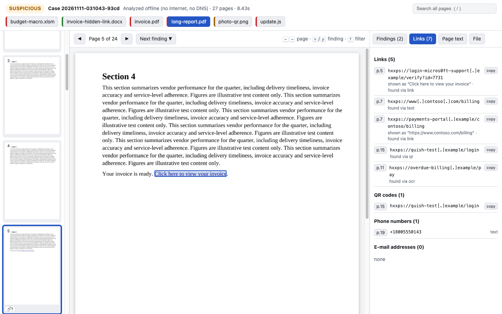
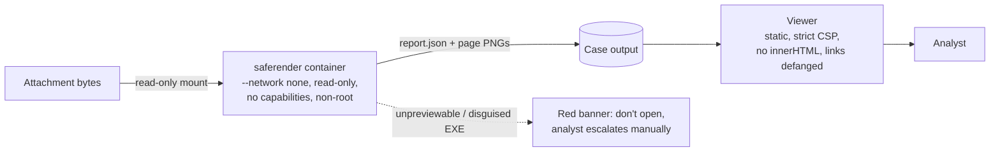

# Safe Attachment Preview for SOC Triage

**Problem.** SOC analysts work suspicious email from a shared triage mailbox. In classic Outlook, shared-mailbox
items are cached on the analyst's PC ("Download shared folders"), so opening or even previewing an attachment writes
it to disk. The people investigating malware end up putting it on company endpoints. At best that sets off EDR
alerts. At worst it causes an incident.

Almost everything in that mailbox turns out to be harmless. The analyst mostly needs to **see** the document: what it
says, where its links go, whether it carries a QR code or a callback number. Detonating it isn't usually the point.

**Solution.** Each attachment is rendered inside a throwaway container that has **no network**. Only harmless output
comes out:

- freshly re-encoded page images (PNG), so nothing from the original file's own encoding survives
- extracted text, with OCR for scanned or image-only pages
- every link, defanged and tied to its page: link annotations, plain text, OCR, QR codes, and Office `.rels` targets
- phone numbers, email addresses, macro source code, and PDF active content
- flags for phishing tells: link text that names one site but opens another, lookalike domains (`micros0ft`,
  `contoso.com.billing-check`), QR codes (quishing), executables disguised as documents, remote-template injection,
  and HTML smuggling patterns
- for forwarded emails (`.eml`): spoofed sender names, Reply-To redirection, failed SPF/DKIM/DMARC, and every
  attachment and inline image unpacked and previewed in turn
- a ClamAV verdict, plus proof in every report that the container really was offline

The analyst reviews all of this in a locked-down web viewer. The original file never reaches their PC. When a file
can't be previewed safely (a real executable, for example), the viewer says so in a red banner, and the analyst escalates it
manually through the team's normal process (hash lookup, detonation sandbox).

> Lab project with **benign test samples only**: the EICAR test string, a harmless macro, harmless PDFs, a fake
> "EXE", and test QR codes and links on reserved `.example` domains. It handles no real organization's email.



## How it works



**One container per case, started on demand.** Nothing runs while it waits. A case comes in, a new container starts,
renders, writes its output, and is destroyed (`docker run --rm`). One case can never see another case's files. The
image is built ahead of time with antivirus signatures baked in, since the container can't download them at run time.

Inside the container (`saferender/saferender/pipeline.py`):

1. **Sniff the real file type** from its bytes, not its name. A `.pdf` that starts with `MZ` gets flagged as a
   disguised executable and is never rendered.
2. **Unpack archives, disk images and emails** (zip, 7z, RAR, gzip/bzip2/xz/tar, CAB, ISO, VHD/VHDX, DMG; 7-Zip and
   bsdtar run as separate programs in the container). Locked zips, 7z files and PDFs are opened with passwords found
   in the email ("The password is 4471"), which is how attackers get files past email filters. Unpacking uses zip-bomb guards: an entry-ratio cap, a total-bytes cap, a file-count cap, and a depth
   limit. Password-protected entries are flagged, because antivirus can't see inside them. Attached emails are
   parsed with Python's standard library, and their attachments and inline images become child files.
3. **Render.** PDFs go through pdfium. Office files are converted to PDF with headless LibreOffice, with macros never
   run. Images are decoded under a pixel limit.
4. **Extract** text, link annotations with their on-page positions, QR codes (zxing), OCR text (tesseract), Office
   relationships, and VBA macros (oletools).
5. **Look below the first layer** (`saferender/saferender/deep.py`). Everything found here goes back through steps 1–4,
   so the search keeps going layer by layer.
   - **PDFs:** every object is decompressed and walked, so active content hidden in compressed object streams is
     still found. The PDF's JavaScript is extracted, and so is every address an action can open (links, form
     submissions, launch actions, remote files, XFA forms). Files embedded in the PDF are unpacked as child files.
   - **Scripts and HTML:** the text is decoded layer by layer: string joins, escape codes, `fromCharCode`, reversed
     strings, base64 and hex. Links that only exist after decoding are reported. Files the page assembles from
     encoded data (HTML smuggling) become child files.
   - **HTML pages are also drawn as pictures,** without their scripts, frames or any external or local resource, so
     QR codes built from table cells can be decoded and the page can be read with OCR.
   - **QR codes that are inverted, low-contrast or tiny** get a second try after the image is cleaned up.
6. **Scan** everything with ClamAV, then write `report.json`. The verdict is MALICIOUS, SUSPICIOUS, NO DETECTIONS
   or NO FILE ATTACHMENTS.

The viewer (`viewer/`) has thumbnails, page navigation (`←`/`→` pages, `n`/`p` jump between findings, `f` shows only pages with findings), search,
a link index grouped by page, and highlight boxes drawn over links and QR codes on the page image.

## Security design

| Control | Where |
|---|---|
| No network at all (`--network none`). Each report records `internetReached` and `dnsResolved` | `scripts/preview-local.sh`, `pipeline.py` `isolation()` |
| Read-only root filesystem. `/tmp` is a size-capped `noexec` tmpfs. Input mounted read-only | `HARDEN` flags in `scripts/preview-local.sh` |
| No Linux capabilities, `no-new-privileges`, non-root UID 10001, caps on PIDs, memory and CPU | same |
| Build-time and run-time separated: compilers live only in the build stage; signatures baked in at build | `saferender/Dockerfile` |
| Output is limited to re-encoded PNGs and JSON text. The original file never leaves | `pipeline.py` `save_page()` |
| Every limit (pages, pixels, zip ratio, timeouts) set in one place | `saferender/saferender/formats.py` `LIMITS` |
| Case IDs regex-validated. Filenames sanitized before touching disk | `pipeline.py`, `formats.py` `safe_name()` |
| Viewer: CSP `default-src 'none'`, `textContent` only (never `innerHTML`), links shown defanged and never clickable, `no-referrer` | `viewer/index.html`, `viewer/app.js` |

### In the cloud: how files get in when the renderer is offline

Cloud container platforms don't offer `--network none`, and *something* has to download the case. So one job run has
two parts with very different trust (`saferender/saferender/fetcher.py`, `lockdown.py`):

1. **Fetcher** (trusted, has network): downloads the case's attachment bytes from private storage using the job's
   managed identity. It never opens or parses them.
2. **Renderer** (untrusted input, no network): started by the fetcher under a Linux **seccomp** filter that the kernel
   enforces on it and every program it launches. Any attempt to open a network socket (TCP, UDP, DNS, raw, netlink,
   io_uring) fails, as does any 32-bit-ABI trick. The filter can't be removed. Its environment is empty: no identity
   endpoint, no storage name, no credentials.
3. **Fetcher** checks the output (only `report.json` and PNGs with expected names, sizes and signatures; symlinks and
   anything else dropped) and uploads it with an `attestation.json`: input hashes, the lock proof for that run, timings,
   and the image version.

Every run proves the lock on the host it's running on before rendering, and **fails closed** if it can't. The nightly
build re-proves it with the network switched on (`scripts/preview-local.sh lockdown-proof`):

```
container (fetcher side), no lock:  internet REACHABLE, DNS RESOLVES
renderer side, under the lock:      {"tcp4": "blocked", "udp4": "blocked", "tcp6": "blocked", "netlink": "blocked", "unix": "open", "dns": "failed"}
```

Full review, including what is **not** solved: [docs/threat-model.md](docs/threat-model.md).

## Verification

40 automated tests run inside the same offline, hardened container the analyst path uses. They prove what an
analyst would see for every sample: the hidden link with its position, OCR-only URLs, QR decode, callback number,
disguised EXE, macro, PDF JavaScript, EICAR, a forwarded phishing email, a BEC bank-change letter, an HTML
login page, a voicemail screenshot, a clean spreadsheet, and the offline proof. Results and timings:
[docs/verification.md](docs/verification.md).

```bash
scripts/preview-local.sh build      # build the engine image (needs internet once, for packages and signatures)
scripts/preview-local.sh samples    # generate the benign test samples
scripts/preview-local.sh test       # 40 passed
scripts/preview-local.sh render dist/samples-v2/long-report.pdf   # opens the viewer
```

Needs Docker only. Everything runs locally, and it costs $0.

## Keeping signatures and parsers current

The rendering container is never online, so it can't update itself. Instead, a GitHub Actions workflow
([`nightly-image.yml`](.github/workflows/nightly-image.yml)) rebuilds the image every night. That build is the only
step with internet: it pulls fresh ClamAV signatures and patched PDF, Office and image libraries, runs all the tests
inside the offline container, and publishes the image only if they pass. The next morning's cases use the new image.

## Why not just use Microsoft Defender or the email gateway?

You should, and this complements them. Gateway and Safe Attachments scanning happens at delivery, and mail that is
rerouted internally, released from quarantine or forwarded into a triage mailbox may not be scanned again, depending
on policy. EDR sees the file only after it is already on the endpoint. This tool covers the moment after delivery, when
a person has to look at the file, and keeps that moment off the workstation. Escalation to a commercial sandbox stays
available, but only for the rare file that needs it.

## Roadmap: cloud version

The local version above is the finished engine. The cloud version swaps the hosting and reuses the mailbox intake that
v1 built and verified:

- **Intake:** analyst drags an email to a `Sandbox` folder. A managed identity, limited by Exchange RBAC for
  Applications to that one mailbox, fetches the attachments.
- **Engine:** Azure Container Apps **Job**, one run per case, scale to zero, no outbound network. Same image, same
  hardening.
- **Viewer:** an Entra ID-protected web app, linked from a short notification email.
- **Infrastructure as code:** Terraform, with nothing running and $0 cost between cases.

## Roadmap: depth (catch everything attackers hide)

The goal is that nothing a file can do to send you somewhere else stays hidden. Each item gets a harmless test sample
that uses the trick, so the test suite proves it's caught.

**Tier 1: hidden content. DONE 2026-11-18** (step 5 above; `tests/test_deep.py` and the depth tests in
`tests/test_samples.py`). Before this, the engine reported NO DETECTIONS on a PDF whose JavaScript sat inside a
compressed object stream.

**Tier 1b: run the page's scripts, safely (needs a decision).** Open HTML attachments in a headless browser inside the
no-network container, and record every address the scripts *try* to reach and every file they try to download.
Nothing gets out. It catches what static decoding can't: scripts that compute links, or that only act on certain
browsers. Trade-off: it adds Chromium to the image, and it would be the first time the engine runs attacker code. The
container's isolation is built for that, but it changes the threat model.

**Tier 2: file types the engine skips today**
- **DONE 2026-11-18:** archives beyond zip (7z, RAR, gzip/bzip2/xz/tar, CAB) and disk images (ISO, VHD/VHDX, DMG,
  raw FAT/NTFS); passwords from the email for zips, 7z (including hidden file names) and PDFs; email > zip > ISO >
  file chains. Known limits: no RAR test sample (free tools can't create RAR files); encrypted RAR can't be opened;
  a large dynamic VHD lists as its full disk size and is refused by the size cap; locked Office files are not tried
  yet.
- **DONE 2026-11-18:** Outlook `.msg` (converted to email: headers, body, attachments and attached emails go through
  the same checks), `.lnk` shortcuts (target and command line, including decoded PowerShell `-enc`), OneNote `.one`
  embedded files, files embedded in Office documents (OLE packages in docx/doc/rtf), DDE fields, Excel 4.0 (XLM)
  macro detection, and protocol-handler links (`ms-msdt:` = Follina, `search-ms:`, `file://` and `\\share` login-hash
  leaks). Known limits: the `.msg` and OneNote test samples are built by our own generator (no free tool writes those
  formats), so real-world files may still surprise us; XLM detection has no test sample yet (needs Excel to create).
- Password-protected Office files (msoffcrypto-tool, MIT): try the passwords found in the email body.
- SVG attachments drawn as pictures (today they're decoded and scanned, but not drawn).
- Email bodies drawn as pictures, so table-cell QR codes in the body itself are found too.

**Tier 3: tricks that fool human eyes**
- Hidden text: compare the text you can see (OCR) with the text in the file. White-on-white text, tiny fonts and
  text placed off the page show up as differences.
- Polyglots and appended data: data after a PDF's end, and files that are valid as two formats at once.
- Detection beyond ClamAV: YARA rules for phishing kits and droppers, and a VirusTotal lookup by hash (lookup only,
  never upload).

## History: v1 (Windows VM sandbox)

The first version used a Terraform-built Windows VM in Azure with no internet and no DNS. Analysts dragged an email to a
folder and got a verdict email back in 37–80 seconds. It worked and was verified live: network isolation, mailbox-scoped
permissions, and four test samples end to end. Code is still here: `terraform/`, `runbooks/`, `sandbox/`,
`scripts/poc.sh`.

What v1 taught, and why v2 exists:

- **The preview is the product, not the scan.** Gateway, EOP and EDR already scan. Analysts needed to see the content
  safely, and a verdict line didn't give them that. A remote desktop into a VM did, but it was slow and clunky.
- **A shared VM is a shared blast radius.** One sample could, in principle, read or forge another case's report. One
  container per case removes that whole class of problem.
- **Cost and startup time.** Two VMs plus Bastion cost about $0.40/hour while running and took minutes to start. A
  container job starts in seconds and costs nothing while idle.
- **DNS is a network path.** The v1 build found and closed a DNS-tunneling gap (Azure DNS stays reachable when
  "no internet" is only an NSG rule). v2 doesn't have this problem, because the container has no network interface at all.

v1 docs: [threat model](docs/v1/threat-model.md), [live verification](docs/v1/verification.md).

## Repo map

```
saferender/   the engine: Dockerfile, pipeline (render + extract + flag), tests, sample generator
viewer/       static analyst viewer (HTML/CSS/JS, no dependencies)
scripts/      preview-local.sh (v2 entry point); poc.sh, exchange-setup.ps1, build tools (v1)
docs/         threat model, verification; docs/v1/ for the VM version
evidence/     viewer screenshots, v1 cost meter snapshot
terraform/, runbooks/, sandbox/   v1 Azure VM sandbox (reference)
```

Step-by-step, non-technical: [attachment-sandbox_how-to.md](attachment-sandbox_how-to.md). MIT licensed.
